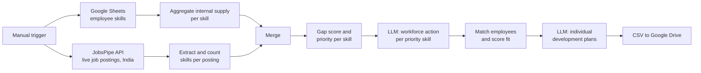

# Live Workforce Skill Intelligence

An AI-powered n8n workflow that compares the skills a company's employees have with the skills the live job market is asking for. It scores every skill gap, ranks priorities, and uses an LLM to recommend workforce actions (upskill, reskill, refresh, hire or monitor) and individual development plans for the best-fit employees.

---

## Problem

HR and L&D teams usually plan training from intuition or annual surveys. They rarely know which skills the market is hiring for right now, how many of their own people hold those skills, or whether those skills are still in active use. This workflow answers three questions automatically:

1. Which skills are in demand in the job market today?
2. Where is the organisation short of active capability in those skills?
3. Which employees should be developed for each priority skill, and how?

## How it works

1. **Internal supply:** reads the `employees_clean` sheet (one row per employee skill) and counts, for every skill, how many employees hold it and how many are active, aging or stale users of it.
2. **Market demand:** calls the JobsPipe job-search API for postings in India from the last 30 days, extracts each posting's technology skills and counts how many distinct postings ask for each skill.
3. **Gap scoring:** merges both views, scores each skill and assigns a priority (see below).
4. **Workforce actions (LLM 1):** sends all Critical and High priority skills to GPT-5 mini, which returns a recommended organisational action for each.
5. **Employee matching:** finds employees who hold each priority skill directly or through a related skill, and scores their fit.
6. **Development plans (LLM 2):** sends the matched employees to GPT-5 mini, which returns a practical development recommendation for each person.
7. **Output:** converts the recommendations to `employee_recommendations.csv` and uploads it to a Google Drive folder.

## Gap scoring

For every skill found in either the market or the workforce:

| Metric | Formula |
| --- | --- |
| Market demand % | job postings asking for the skill ÷ postings for the most-demanded skill × 100 |
| Active supply % | active employees with the skill ÷ all employees with the skill × 100 |
| Shortage % | 100 − active supply % |
| **Gap score** | **0.6 × market demand % + 0.4 × shortage %** |

| Gap score | Priority |
| --- | --- |
| 70 and above | Critical |
| 50 to 69.99 | High |
| 30 to 49.99 | Medium |
| Below 30 | Low |

Market demand carries more weight (60%) because a skill nobody is hiring for is not urgent, however thin internal supply is.

## Employee fit score

Each employee is scored against each priority skill, capped at 100:

| Factor | Points |
| --- | --- |
| Holds the skill directly | 60 |
| Holds a related skill | 40 |
| Skill level: advanced / intermediate / beginner | +20 / +15 / +8 |
| Activity: active / aging / stale | +15 / +8 / +3 |
| Experience: 5+ years / 2+ years | +5 / +3 |

The top 5 direct and top 5 related candidates are kept for each skill. The employee-level action follows simple rules: a direct match who uses the skill actively is marked **Upskill**, a direct match whose use is aging or stale is marked **Refresh**, and a related match is marked **Reskill**.

## AI layer

Both LLM steps use n8n's LangChain nodes with OpenAI GPT-5 mini and a **structured output parser**, so the model always returns valid JSON in a fixed schema.

- **Workforce Planning Analyst:** chooses Upskill, Reskill, Refresh, Hire or Monitor for each priority skill, with urgency, a reason, and flags for whether hiring or development is needed.
- **Employee Development Advisor:** turns each employee match into a personal development recommendation. It is told never to recommend "Hire" for an existing employee.

Both prompts tell the model to use only the supplied data and never invent or recalculate numbers. All scoring is done in code before the model sees it.

## Output

`employee_recommendations.csv`, uploaded to Google Drive, with one row per employee and target skill:

`employee_id`, `employee_name`, `current_skill`, `target_skill`, `priority`, `match_type`, `fit_score`, `recommended_action`, `development_recommendation`, `reason`, `urgency`

## Tech stack

- **n8n** for orchestration
- **JavaScript** Code nodes for aggregation, gap scoring and fit scoring
- **Google Sheets** as the employee skills database
- **JobsPipe API** for live job postings
- **OpenAI GPT-5 mini** through n8n LangChain nodes, with structured output parsing
- **Google Drive** for the output file

## Input data

The `employees_clean` sheet needs one row per employee skill with these columns:

| Column | Example |
| --- | --- |
| `employee_id` | EMP0005 |
| `employee_name` | Employee name |
| `department` | Analytics |
| `job_role` | Data Analyst |
| `skill` | Excel |
| `skill_level` | Beginner / Intermediate / Advanced |
| `activity_status` | Active / Aging / Stale |
| `months_since_last_used` | 4 |
| `years_of_experience` | 3 |
| `related_skills` | Comma-separated list, e.g. `power bi, sql` |

## Setup

1. Import `workflow/Live_Workforce_Skill_Intelligence.json` into n8n (Workflows → Import from file).
2. Add credentials for Google Sheets, Google Drive and OpenAI.
3. In the **HTTP Request1** node, replace `YOUR_JOBSPIPE_API_KEY` with your own JobsPipe key.
4. In **Get row(s) in sheet**, replace `YOUR_GOOGLE_SHEET_ID` with your sheet's ID.
5. In **Upload file**, replace `YOUR_DRIVE_FOLDER_ID` with the destination folder's ID.
6. Click **Execute workflow**.

The exported workflow fetches 10 postings per run; raise `limit` in the HTTP request body for a broader market view.

## Limitations and next steps

- Market skills come from each posting's technology tags, so soft skills and domain knowledge are not captured.
- Internal and market skills match on normalised names; synonyms such as "MS Excel" and "Excel" need a mapping table.
- The workflow runs on a manual trigger; a scheduled trigger would make it a monthly skills report.
- A next step is to track gap scores over time to show which skills are rising or falling in demand.

## Author

**Aditi Agarwal**
PGDM (Big Data Analytics), FORE School of Management
[LinkedIn](https://www.linkedin.com/in/aditi-agarwal-323174280) · [GitHub](https://github.com/aditiagarwal2410)
